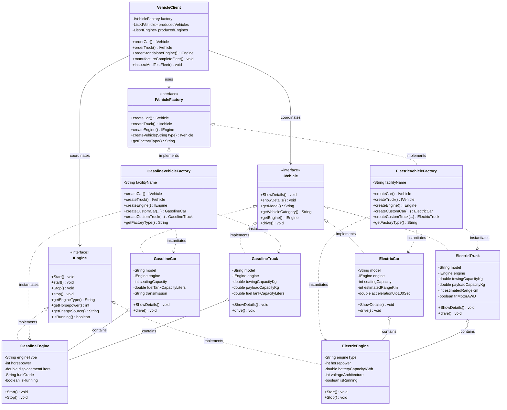

# Vehicle Manufacturing System - Abstract Factory Pattern
> **Course:** Software Architecture & Design Patterns  
> **Assignment:** In-class Activity 04 — Abstract Factory Design Pattern  
> **Specification Document:** [`Inclass 04 - Abstract Factory.docx`](file:///Inclass%2004%20-%20Abstract%20Factory.docx)

---

## 📋 Executive Summary

This project implements an enterprise-grade vehicle manufacturing simulation utilizing the **Abstract Factory Design Pattern** in pure Java. The system models a multi-powertrain manufacturing company capable of producing distinct families of vehicles (**Cars** and **Trucks**) equipped with matching engine architectures (**Gasoline Internal Combustion** and **Zero-Emission Electric Powertrains**).

---

## 🎯 Requirements & Implementation Matrix

| Requirement Specification | Interface / Class in Project | Description & Responsibility |
|---|---|---|
| **Abstract Factory Interface** | [`IVehicleFactory`](file:///src/main/java/com/vehiclefactory/factory/IVehicleFactory.java) | Declares creation contracts for `createCar()`, `createTruck()`, and `createEngine()`. |
| **Concrete Factory 1** | [`GasolineVehicleFactory`](file:///src/main/java/com/vehiclefactory/factory/GasolineVehicleFactory.java) | Produces gasoline-powered vehicles and engines (`GasolineCar`, `GasolineTruck`, `GasolineEngine`). |
| **Concrete Factory 2** | [`ElectricVehicleFactory`](file:///src/main/java/com/vehiclefactory/factory/ElectricVehicleFactory.java) | Produces electric vehicles and motors (`ElectricCar`, `ElectricTruck`, `ElectricEngine`). |
| **Abstract Product A (Vehicle)** | [`IVehicle`](file:///src/main/java/com/vehiclefactory/product/IVehicle.java) | Product interface mandating `void ShowDetails()`, `getModel()`, `getEngine()`, and `drive()`. |
| **Abstract Product B (Engine)** | [`IEngine`](file:///src/main/java/com/vehiclefactory/product/IEngine.java) | Product interface mandating `void Start()`, `void Stop()`, `getHorsepower()`, and `getEngineType()`. |
| **Concrete Product: Gasoline Car** | [`GasolineCar`](file:///src/main/java/com/vehiclefactory/product/GasolineCar.java) | Passenger sedan with 2.5L Turbo ICE, fuel tank, and 8-speed transmission. Implements `ShowDetails()`. |
| **Concrete Product: Gasoline Truck**| [`GasolineTruck`](file:///src/main/java/com/vehiclefactory/product/GasolineTruck.java) | Heavy-duty utility hauler with 5.0L V8 ICE, 6,200kg towing capacity. Implements `ShowDetails()`. |
| **Concrete Product: Electric Car** | [`ElectricCar`](file:///src/main/java/com/vehiclefactory/product/ElectricCar.java) | High-performance EV sedan with 92 kWh battery, 540km range, and 3.2s 0-100 km/h. Implements `ShowDetails()`. |
| **Concrete Product: Electric Truck**| [`ElectricTruck`](file:///src/main/java/com/vehiclefactory/product/ElectricTruck.java) | Tri-motor AWD electric hauler with 135 kWh battery, 7,200kg towing. Implements `ShowDetails()`. |
| **Concrete Product: Gasoline Engine**| [`GasolineEngine`](file:///src/main/java/com/vehiclefactory/product/GasolineEngine.java) | Spark-ignition internal combustion engine. Implements `Start()` and `Stop()`. |
| **Concrete Product: Electric Engine**| [`ElectricEngine`](file:///src/main/java/com/vehiclefactory/product/ElectricEngine.java) | High-voltage electric drive unit with instantaneous torque. Implements `Start()` and `Stop()`. |
| **Client Decoupling** | [`VehicleClient`](file:///src/main/java/com/vehiclefactory/client/VehicleClient.java) | Assembly pipeline operating strictly on `IVehicleFactory`, `IVehicle`, and `IEngine` interfaces. |
| **Main Demonstration** | [`Main`](file:///src/main/java/com/vehiclefactory/main/Main.java) | Full demonstration creating vehicles dynamically based on selected engine type (CLI & interactive). |
| **Unit Test Suite** | [`VehicleFactoryTest`](file:///src/test/java/com/vehiclefactory/VehicleFactoryTest.java) | 39 automated unit test assertions validating all requirements without external dependencies. |

---

## 📐 UML Class Diagram



---

## 📁 Project Folder Structure

```
c:\Users\Methma\Desktop\New folder (2)\
├── pom.xml                                     # Maven Project Configuration (IntelliJ / NetBeans / VS Code)
├── run.bat                                     # 1-Click Windows Batch Runner (Compiles & Executes Main)
├── run.ps1                                     # PowerShell Runner
├── test.bat                                    # 1-Click Unit Test Runner (39 Assertions)
├── test.ps1                                    # PowerShell Test Runner
├── README.md                                   # Comprehensive Project Guide & Documentation
├── ARCHITECTURE.md                             # Deep Dive into Abstract Factory Pattern Architecture
├── Inclass 04 - Abstract Factory.docx          # Original Assignment Specification Document
├── src\
│   ├── main\
│   │   └── java\
│   │       └── com\
│   │           └── vehiclefactory\
│   │               ├── factory\
│   │               │   ├── IVehicleFactory.java        # Abstract Factory Interface
│   │               │   ├── GasolineVehicleFactory.java # Concrete Factory for Gasoline Family
│   │               │   └── ElectricVehicleFactory.java # Concrete Factory for Electric Family
│   │               ├── product\
│   │               │   ├── IVehicle.java               # Abstract Product: Vehicle
│   │               │   ├── IEngine.java                # Abstract Product: Engine
│   │               │   ├── GasolineCar.java            # Concrete Product: Gasoline Car
│   │               │   ├── GasolineTruck.java          # Concrete Product: Gasoline Truck
│   │               │   ├── ElectricCar.java            # Concrete Product: Electric Car
│   │               │   ├── ElectricTruck.java          # Concrete Product: Electric Truck
│   │               │   ├── GasolineEngine.java         # Concrete Product: Gasoline Engine
│   │               │   └── ElectricEngine.java         # Concrete Product: Electric Engine
│   │               ├── client\
│   │               │   └── VehicleClient.java          # Decoupled Assembly Client
│   │               └── main\
│   │                   └── Main.java                   # Demonstrator & Interactive Configurator
│   └── test\
│       └── java\
│           └── com\
│               └── vehiclefactory\
│                   └── VehicleFactoryTest.java         # Automated Suite (39 Tests)
└── bin\                                        # Compiled Java Bytecode (.class files)
```

---

## 🚀 How to Run & Test

### Option 1: One-Click Windows Batch Scripts (Recommended)

Simply double-click or execute from Command Prompt / PowerShell:
- **Run the full system demonstration:**
  ```cmd
  run.bat
  ```
- **Run the automated unit test suite:**
  ```cmd
  test.bat
  ```
- **Launch Interactive Configurator:**
  ```cmd
  run.bat --interactive
  ```
- **Direct CLI Execution by Engine & Vehicle:**
  ```cmd
  run.bat gasoline car
  run.bat electric truck
  ```

### Option 2: PowerShell Scripts
- **Run application:**
  ```powershell
  .\run.ps1
  ```
- **Run tests:**
  ```powershell
  .\test.ps1
  ```
- **Interactive mode:**
  ```powershell
  .\run.ps1 --interactive
  ```

### Option 3: Standard `javac` and `java` (No Maven Required)
```powershell
# 1. Compile
javac -d bin src/main/java/com/vehiclefactory/*/*.java src/test/java/com/vehiclefactory/*.java

# 2. Run Main
java -cp bin com.vehiclefactory.main.Main

# 3. Run Unit Tests
java -cp bin com.vehiclefactory.VehicleFactoryTest
```

### Option 4: Apache NetBeans / IntelliJ IDEA / Eclipse
1. Open your IDE.
2. Select **File -> Open...** and point to `c:\Users\Methma\Desktop\New folder (2)`.
3. The project is recognized automatically via [`pom.xml`](file:///pom.xml).
4. Run or Debug [`Main.java`](file:///src/main/java/com/vehiclefactory/main/Main.java) or [`VehicleFactoryTest.java`](file:///src/test/java/com/vehiclefactory/VehicleFactoryTest.java).

---

## 🧪 Automated Unit Test Results

The test suite in [`VehicleFactoryTest.java`](file:///src/test/java/com/vehiclefactory/VehicleFactoryTest.java) verifies 39 distinct test conditions:

```
==================================================
     RUNNING VEHICLE ABSTRACT FACTORY TESTS       
==================================================

--- Testing GasolineVehicleFactory Product Family ---
 [PASS] Gasoline factory creates non-null car
 [PASS] Car is instance of GasolineCar
 [PASS] Car engine is instance of GasolineEngine
 [PASS] Car category is passenger car
 [PASS] Gasoline factory creates non-null truck
 [PASS] Truck is instance of GasolineTruck
 [PASS] Truck engine is instance of GasolineEngine
 [PASS] Gasoline factory creates non-null engine
 [PASS] Engine is instance of GasolineEngine

--- Testing ElectricVehicleFactory Product Family ---
 [PASS] Electric factory creates non-null car
 [PASS] Car is instance of ElectricCar
 [PASS] Car engine is instance of ElectricEngine
 [PASS] Electric factory creates non-null truck
 [PASS] Truck is instance of ElectricTruck
 [PASS] Truck engine is instance of ElectricEngine
 [PASS] Electric factory creates non-null engine
 [PASS] Engine is instance of ElectricEngine

--- Testing Gasoline Engine Start & Stop Lifecycle ---
 [PASS] Engine starts in STOPPED state
 [PASS] Engine is RUNNING after Start()
 [PASS] Engine is STOPPED after Stop()
 [PASS] Engine horsepower matches

--- Testing Electric Engine Start & Stop Lifecycle ---
 [PASS] Engine starts in OFFLINE state
 [PASS] Engine is RUNNING after Start()
 [PASS] Engine is OFFLINE after Stop()
 [PASS] Electric horsepower matches

--- Testing ShowDetails() on All Concrete Products ---
 [PASS] ShowDetails() executes cleanly for all 4 vehicle types

--- Testing createVehicle(type) Polymorphic Dispatch ---
 [PASS] createVehicle('car') returns GasolineCar
 [PASS] createVehicle('truck') returns GasolineTruck

--- Testing VehicleClient Decoupled Assembly ---
 [PASS] Client produced 2 vehicles
 [PASS] Client produced 1 standalone engine
 [PASS] Client car is ElectricCar
 [PASS] Client truck is ElectricTruck
 [PASS] Client engine is ElectricEngine

--- Testing Custom Factory Methods ---
 [PASS] Custom car model name matches
 [PASS] Custom car horsepower matches
 [PASS] Custom truck model name matches
 [PASS] Custom truck towing matches

--- Testing Error Handling for Invalid Vehicle Types ---
 [PASS] Properly threw IllegalArgumentException on invalid vehicle type
 [PASS] Properly threw IllegalArgumentException on null vehicle type

--------------------------------------------------
TEST SUMMARY: 39 Passed, 0 Failed
--------------------------------------------------
ALL TESTS PASSED SUCCESSFULLY!
```

---

## 💡 Key Design Highlights

1. **Strict Family Consistency:** `GasolineVehicleFactory` guarantees that all manufactured vehicles are equipped exclusively with gasoline internal combustion engines. `ElectricVehicleFactory` guarantees that all vehicles are equipped exclusively with zero-emission electric powertrains.
2. **Method Compatibility:** Both PascalCase (`ShowDetails()`, `Start()`) as explicitly mandated by the assignment doc and idiomatic Java camelCase (`showDetails()`, `start()`) are supported via default interface methods.
3. **Open/Closed Principle:** Introducing a new powertrain family (such as `HydrogenVehicleFactory`, `HydrogenCar`, `HydrogenTruck`, `HydrogenEngine`) requires zero modifications to existing factories or client code.
# Inclass-Activity-04

